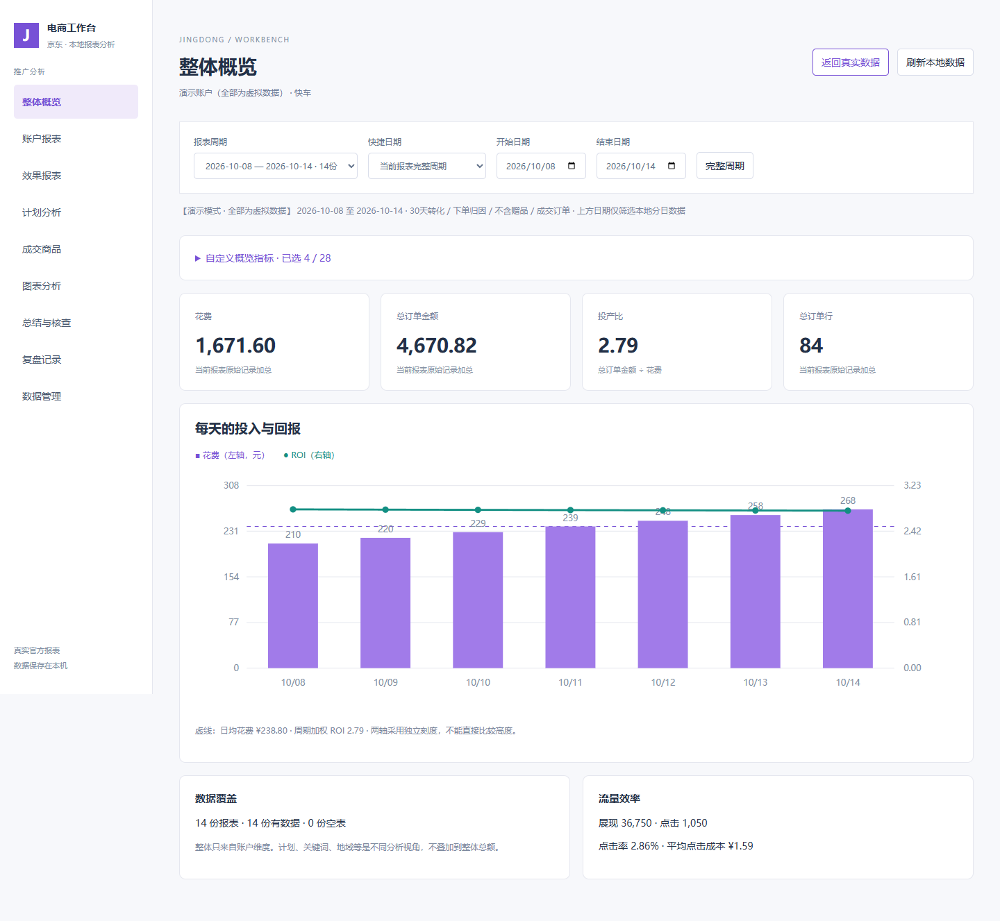
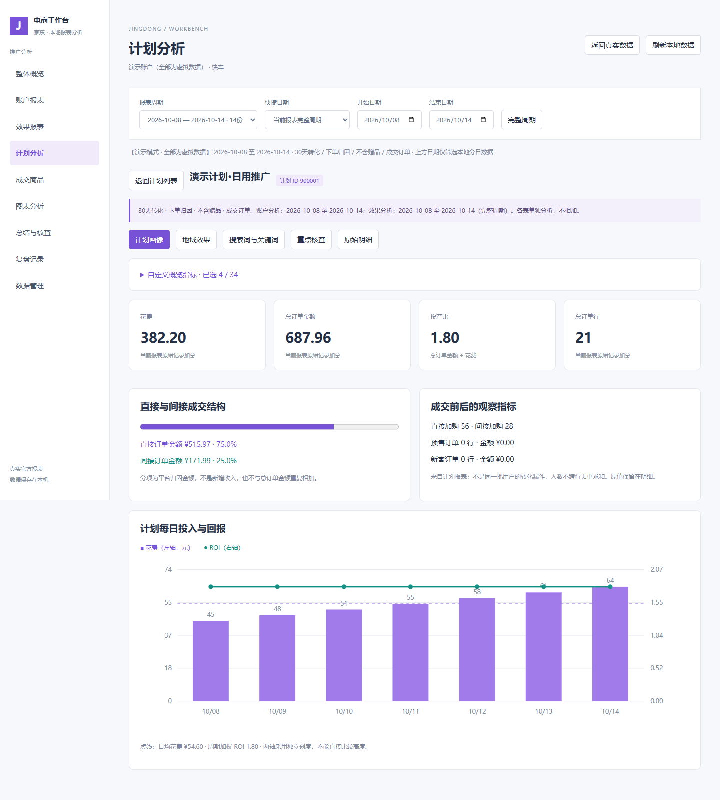
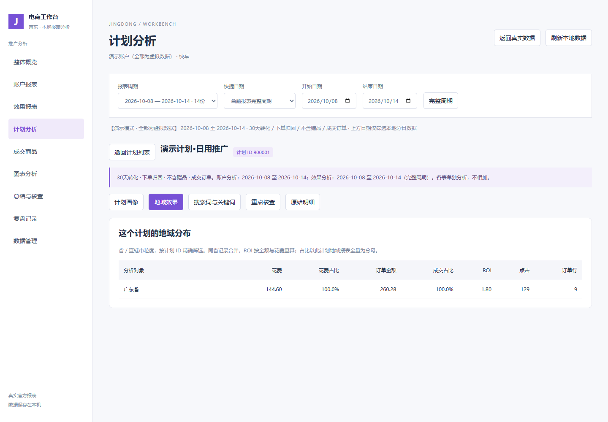
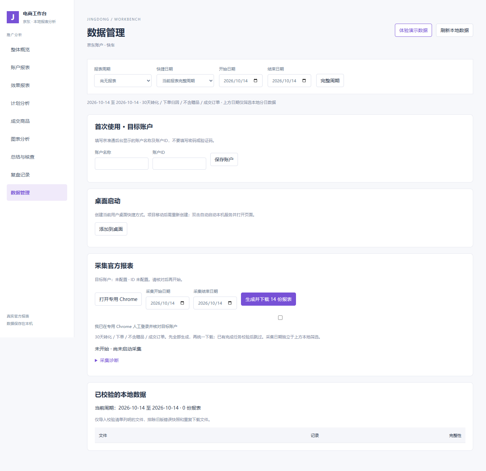

# 京东推广工作台 1.0

在本机下载京准通快车官方报表，按账户、计划、关键词、搜索词和地域分析投放数据。非京东官方产品，目前支持 Windows 和 Google Chrome。



## 开始使用

需要 Python 3.12+、Google Chrome，首次安装依赖需要网络。

```powershell
powershell -NoProfile -ExecutionPolicy Bypass -File .\安装依赖.ps1
```

安装完成后双击 `启动工作台.cmd`，或运行 `启动工作台.ps1`。访问 `http://127.0.0.1:5192/`。

- 先点“体验演示数据”，无需账号查看14种报表与计划专题。所有演示内容为程序生成的虚拟数据。
- 真实使用：数据管理 → 保存账户名称和ID → 打开专用Chrome → 人工登录并进入快车账户报表页 → 核对账户 → 选择采集日期 → 生成并下载。
- 数据管理支持“添加到桌面”，每个用户生成自己电脑上的启动快捷方式。
- 完整说明及排查步骤见 [使用说明](docs/使用说明.md)。

## 功能

| 模块 | 功能 |
|---|---|
| 整体概览 | 自定义指标、分日趋势、花费与成交、加权ROI |
| 账户报表 | 账户、计划、单元、创意、关键词、商品定向、人群、流量包 |
| 效果报表 | 搜索词、地域、商品定向、品类、商品、品牌追击 |
| 计划分析 | 按计划ID关联地域、搜索词、关键词、单元及创意；成交结构与重点核查 |
| 成交商品 | 查看跟单SKU，不凭名称猜测计划关系 |
| 明细与复盘 | 全字段自选、筛选、排序、导出、原始记录、复盘JSON备份 |
| 数据管理 | 配置账户、桌面快捷方式、日期采集、任务进度与恢复提示 |







## 数据口径与限制

固定30天转化／下单归因／不含赠品／成交订单。账户表分日，效果表保留完整周期，不把效果汇总拆成每日；不同表总额不相加。ROI按订单金额÷花费计算，不代表利润。原始字段全部保留；用户去重指标不跨行加总。

下载先生成全部任务，再集中领取文件，校验日期、结构、ROI及SHA-256。已完成任务复核后跳过；不确定提交停止核对，避免重复生成。历史日期可选择，但实际可用范围由平台决定。暂不覆盖全站营销、站外广告、订单明细和洞察报表。

登录与验证码由本人处理，不绕过风控，不读取或导出登录凭据，不修改投放。钉钉通知尚未实现。仅支持本机单人使用，服务绑定127.0.0.1，不应公开部署。

## 隐私与验收

发布包不含真实报表、浏览器登录环境、账户配置或经营复盘。data、.venv、config.local.json及交付目录均被忽略。复盘和界面偏好保存在当前浏览器，请导出备份；不是云同步。

新电脑首次商家登录、真实验证码恢复及真实生成瞬间强制断电后的恢复仍待独立验收。本机通过不代表所有账户或未来页面均兼容。

## 开发测试

```powershell
.venv\Scripts\python.exe -m unittest discover -s scripts -p "test_*.py"
.venv\Scripts\python.exe scripts\workbench_server.py --port 5194
# 在另一终端验证演示及首次使用页面
.venv\Scripts\python.exe scripts\verify_release_ui.py --url http://127.0.0.1:5194
```

单元测试使用临时合成数据和新无头Chrome，不读取商家登录环境。依赖见 requirements.txt；需自行安装Chrome，无需 Playwright install。

## 人工导入 CSV

自动采集入口也支持报表范围：只取计划（1份）、计划＋关键词＋搜索词＋地域（4份）、全部14份。复用同一采集流程，先生成所选报表再统一下载；完成校验以本次所选维度为准。同周期自动采集可补齐其余维度，已校验文件保留；人工导入周期请继续人工补齐，避免混合来源。

数据管理中保存目标账户后，选择报表日期和1–14份原始CSV，点击“校验并预览”，核对维度并确认账户及归因口径，再确认导入。支持UTF-8和GB18030，单文件最多12MB、批次总计23MB；不支持XLSX或ZIP。

可分批补齐报表。缺失维度标为未导入，不作为零数据；相同文件跳过，同周期同维度不同快照拒绝覆盖。原件及导入记录保存在本机data/imports，校验后数据进入本地报表周期。CSV不能证明账户及归因设置，须本人核对30天转化、下单、不含赠品、成交订单、全部营销目标，以及账户表分日、效果表周期汇总。

MIT License。第三方依赖遵循各自许可证。
